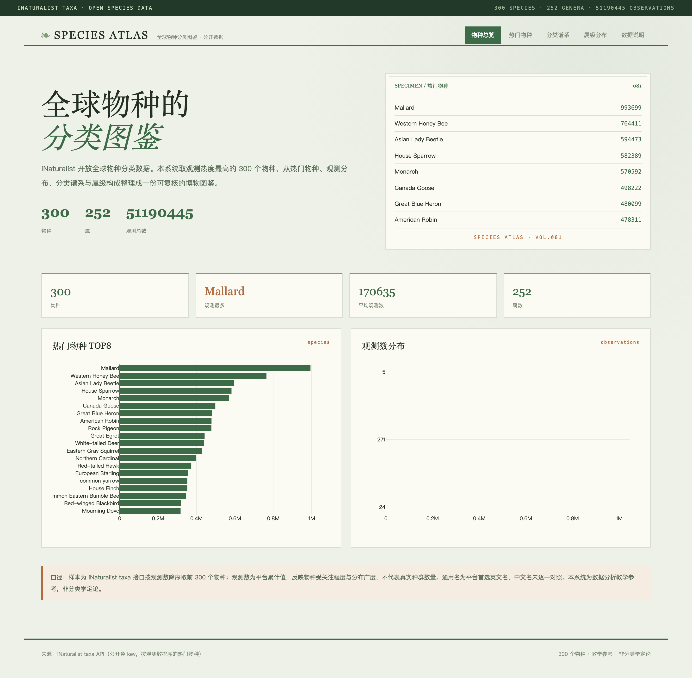
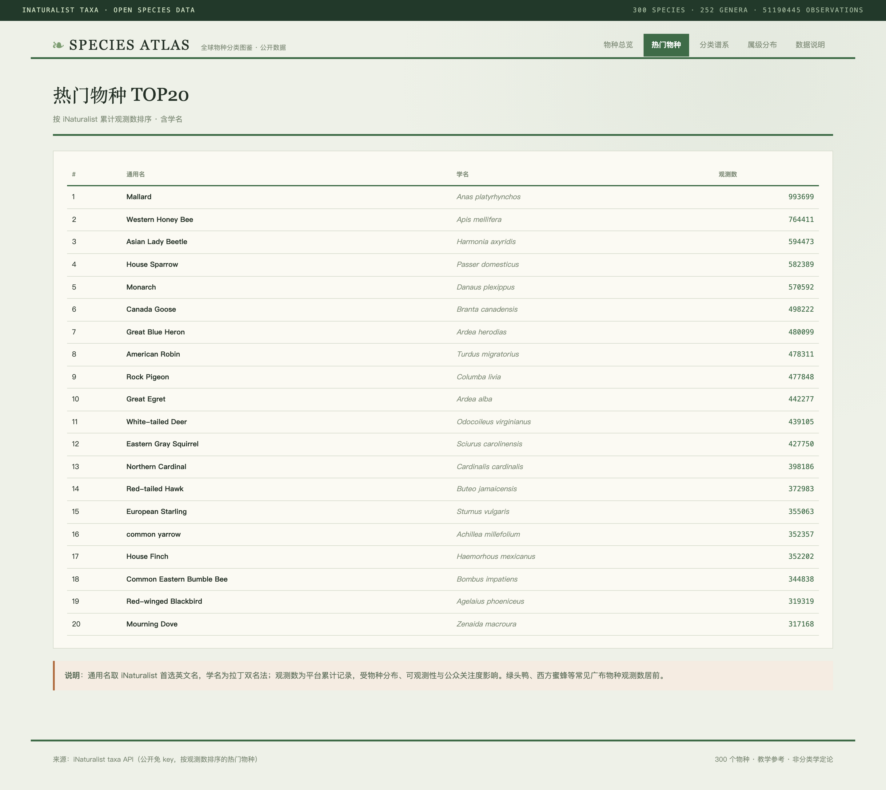
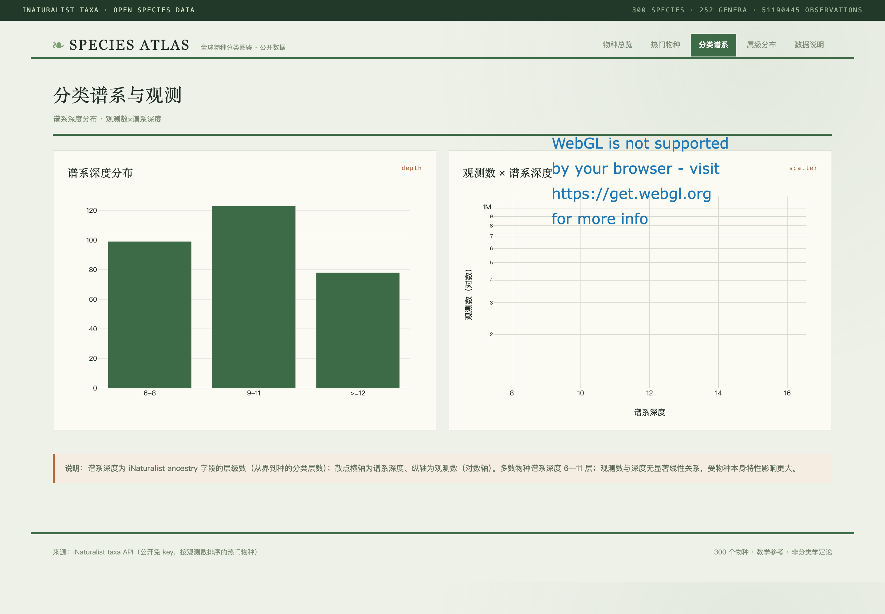
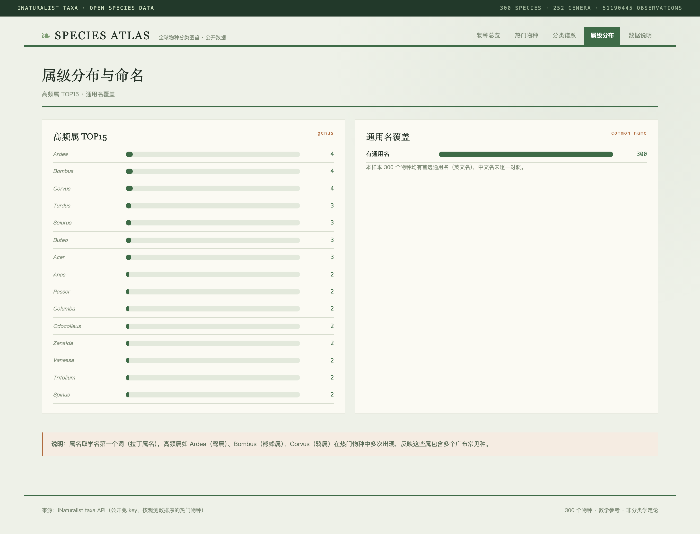
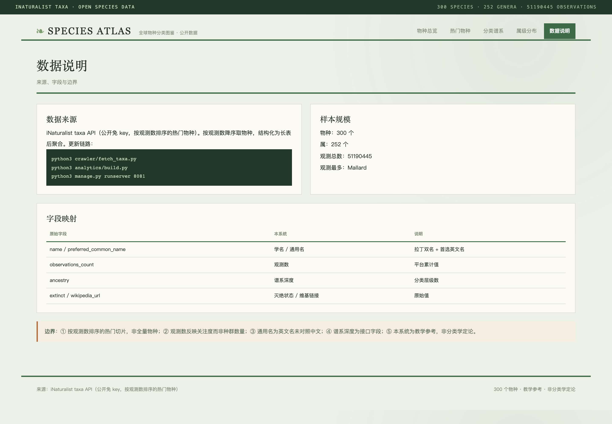

# 081 基于iNaturalist公开数据的全球物种分类与观测分析系统-设计展示

> **代码有偿获取 可接受定制 微信联系方式: csbysj2020 或 ACE2487，备注(BS)**

> **完整源码与全套文档 · 在线自助获取 >>> [https://mbd.pub/o/bread/YZaWmJpyZQ==](https://mbd.pub/o/bread/YZaWmJpyZQ==)**

> **成品页（功能介绍 / 更多选题）>>> [https://bishe.suilang.net/products/species-atlas](https://bishe.suilang.net/products/species-atlas)**

> 

> 

## 视频

> **点击查看 >>> [https://www.bilibili.com/video/BV1K9yazaEZm/](https://www.bilibili.com/video/BV1K9yazaEZm/)**

## 项目简介

自然博物图鉴风格（苔藓绿、羊皮纸、植物标本框），区别于调酒图鉴/奥运领奖台/气象预警中心。采集 iNaturalist 公开物种 300 个（252 属、51190445 次观测），从热门物种、观测分布与分类谱系多维分析。Django + Plotly.js（本地化离线可用），5 个页面。观测偏差与通用名口径如实标注，非分类学定论。

物种分类数据是观察生物多样性热点的数据窗口。

本项目设计并实现了一套基于 iNaturalist 公开数据的物种分类与观测分析系统：通过 taxa API 按观测数降序获取 300 个热门物种，解析学名、通用名、谱系与观测数，从热门物种、观测分布、谱系深度与属级构成四个维度聚合分析。

系统采用 Django + Plotly.js 与自然博物图鉴式界面（苔藓绿、羊皮纸、植物标本框），实现物种总览、热门物种、分类谱系、属级分布、数据说明 5 个页面。

本仓库为**设计展示**：包含项目说明、技术架构、实验结果与运行截图；完整源码、任务书、开题报告、毕业论文与使用说明可通过上方链接自助获取，成品页可查看更多选题，也可联系微信咨询定制。

## 功能特性

1. 差异化视觉：自然博物图鉴（苔藓绿/羊皮纸/标本框），非看板/画廊/调酒图鉴

2. 真实采集：iNaturalist taxa API 公开免 key，300 个热门物种

3. 热门物种：观测数 TOP20 与学名对照

4. 观测分布：观测数区间分箱

5. 分类谱系：谱系深度分布与观测数散点

6. 属级分布：高频属 TOP15（鹭属/熊蜂属/鸦属）

7. 技术栈差异化：Django + Plotly.js（本地化）

8. 合规边界：热门切片、观测偏差、非分类学定论

## 技术架构

| 项目 | 说明 |
| --- | --- |
| 编程语言 | Python 3.8+ |
| Web 框架 | Django 4.2 |
| 图表 | Plotly.js（本地化离线可用） |
| 数据源 | iNaturalist taxa API（公开免 key） |
| 样本规模 | 300 物种 / 252 属 / 51190445 观测 |
| 运行端口 | http://127.0.0.1:8081 |
| 说明 | 数据直读 analysis JSON，无需数据库 |

## 目录结构

以下为完整交付版的结构（本仓库仅作设计展示）：

```
species-atlas/
├── analytics/
│   └── build.py
├── crawler/
│   └── fetch_taxa.py
├── data/
│   ├── analysis/
│   │   ├── common_name.json
│   │   ├── depth_bins.json
│   │   ├── genera.json
│   │   ├── obs_bins.json
│   │   ├── scatter.json
│   │   ├── top20.json
│   │   └── wikipedia.json
│   ├── processed/
│   │   └── taxa.csv
│   └── stats.json
├── static/
│   ├── css/
│   │   └── style.css
│   └── vendor/
│       └── plotly.min.js
├── taxonapp/
│   ├── __init__.py
│   └── app.py
├── taxonproj/
│   ├── __init__.py
│   ├── settings.py
│   ├── urls.py
│   └── wsgi.py
├── templates/
│   ├── about.html
│   ├── base.html
│   ├── genera.html
│   ├── overview.html
│   ├── phylogeny.html
│   └── species.html
├── 任务书/
│   └── 毕业设计任务书.docx
├── 开题报告/
│   └── 毕业设计开题报告.docx
├── 最终论文/
│   ├── 图/
│   └── …
└── …
```

## 数据与实验结论

- 实验显示样本覆盖 252 个属、累计 51190445 次观测，Mallard 为观测最多的物种，多数物种谱系深度 6—11 层。
- 真实采集：iNaturalist taxa API 公开免 key，300 个热门物种
- 热门物种：观测数 TOP20 与学名对照
- 属级分布：高频属 TOP15（鹭属/熊蜂属/鸦属）

## 交付内容

1. 完整源码（Django 应用 + 采集器 + 分析引擎 + 5 页面）
2. 真实数据（taxa.csv + analysis JSON）
3. 任务书与开题报告（Word）
4. 毕业论文（Word 七章制）
5. 二次开发说明（Word+md）
6. 5 张截图 + 封面 + 演示视频

## 常见问题

**观测数等于种群数量吗？**

不等于，是平台累计记录，反映关注度与可观测性。

**通用名是中文吗？**

是 iNaturalist 首选英文名，中文名未逐一对照。

**谱系深度是什么？**

ancesty 字段的分类层级数，从界到种。

**图表能离线用吗？**

能，plotly.min.js 已本地化到 static/vendor/。

## 截图






